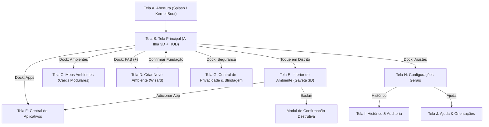

# MAPA COMPLETO DE TELAS — A ILHA

Este documento descreve a topologia de navegação, estados, componentes principais e comportamento de transição de cada uma das telas de A ILHA.

---

## Diagrama Geral de Fluxo

---

## 1. Tela A: Abertura (Splash Screen)
- **Função**: Inicialização da interface, boas-vindas visuais e exibição de integridade do ambiente.
- **Elementos**:
  - Logotipo animado em perspectiva isométrica com anel de pulso (*ripple*).
  - Indicador de progresso com gradiente ciano-azul.
  - Telemetria de boot: `K_BOOT: ESPAÇOS_ISOLADOS [OK]`.
  - Botão de entrada com feedback tátil.
- **Estados**:
  - `Carregando`: Rotação e pulso de luz do logotipo, barra de progresso ativa.
  - `Concluído`: Transição suave de esmaecimento (`opacity: 0`, `visibility: hidden`).
  - `Recuperação/Erro`: Botão de repetição de inicialização caso o motor gráfico falhe.

---

## 2. Tela B: Tela Principal (A Ilha 3D + HUD)
- **Função**: O coração explorável da aplicação. Ocupa 80%+ da tela com o território digital interativo.
- **Elementos**:
  - **Oceano Digital**: Ondas discretas de pulso concêntrico e malha de grade suave.
  - **Platô da Ilha**: Strata rochosa e tecnológica com contorno emissivo.
  - **4 Distritos Físicos + Setor de Expansão**:
    1. *Trabalho & Produção*: Arranha-céus com iluminação de dados.
    2. *Pessoal & Social*: Cúpula geodésica bioluminescente e jardins solares.
    3. *Cofre Financeiro*: Fortaleza de obsidiana com bastiões e cofre rúnico dourado.
    4. *Laboratório Sandbox*: Pilares suspensos por anti-gravidade com feixes de plasma.
    5. *Área de Expansão*: Malha de blueprint holográfica.
  - **Nexus Central**: Bastião hexagonal com monólito cristalino e feixe vertical.
  - **Badges Flutuantes 3D**: Projetam o nome, contagem de apps e status (Ativo/Pausado) acima de cada distrito.
  - **Top HUD**: Logo da Ilha, beacon de integridade verde, alternador de modo escuro/claro, seletor de moldura mobile e atalho de ajuda.
  - **Dock Inferior**: Navegação ergonômica para polegares com botão FAB central destacado.

---

## 3. Tela C: Meus Ambientes
- **Função**: Visão de gerenciamento modular dos ambientes cadastrados.
- **Elementos**:
  - Cards modulares de ambiente com cor de destaque lateral.
  - Ícone representativo, nome, bioma e data de último acesso.
  - Badge de status (`Ativo` em verde ou `Pausado` em âmbar).
  - Linha de chips de aplicativos instalados.
  - Resumo de armazenamento alocado.
  - Ação rápida "Explorar Território" que foca a câmera 3D no distrito correspondente.

---

## 4. Tela D: Criar Novo Ambiente (Wizard de Expansão)
- **Função**: Fluxo guiado e intuitivo para adicionar um novo espaço à Ilha.
- **Passos do Fluxo**:
  1. *Identificação*: Nome do novo ambiente e descrição opcional.
  2. *Arquitetura / Bioma*: Escolha entre Neo-Metrópole, Oásis, Cidadela ou Laboratório.
  3. *Identidade Visual*: Paleta cromática (Ciano, Esmeralda, Âmbar, Violeta).
  4. *Políticas de Isolamento*: Padrão, Estrito ou Quarentena Temporária.
  5. *Fundação*: Conclusão da terraformação com novo setor renderizado na Ilha.

---

## 5. Tela E: Interior do Ambiente (Gaveta 3D)
- **Função**: Inspeção aprofundada de um distrito selecionado na Ilha.
- **Elementos**:
  - Título e badge de status do distrito.
  - Cartões de telemetria: Armazenamento utilizado (ex: 8.4 GB) e Memória RAM alocada (ex: 1.1 GB).
  - Grade de aplicativos associados com versão e categoria.
  - Lista de blindagens e regras ativas (ex: Isolamento de contatos, Câmera sob confirmação).
  - Botão de ação primária: "Pausar Ambiente" / "Retomar Ambiente".
  - Botão de ação destrutiva: "Excluir Ambiente" (aciona modal de confirmação).

---

## 6. Tela F: Central de Aplicativos
- **Função**: Catálogo geral de aplicativos instaláveis nos ambientes isolados.
- **Elementos**:
  - Campo de busca instantânea com filtro por nome e categoria.
  - Lista de apps disponíveis com tamanho de pacote e ícone.
  - Ação "Instalar em..." com seletor de distrito alvo.

---

## 7. Tela G: Central de Privacidade & Segurança
- **Função**: Transparência e controle de isolamento de dados.
- **Elementos**:
  - Medidor de blindagem (96% Nominal).
  - Lista de escudos ativos (Separação de armazenamento, Chaves criptográficas, Restrição de clipboard).
  - Alertas preventivos de segurança.
  - Banner explicativo de conformidade técnica Android.

---

## 8. Tela H: Configurações Gerais
- **Função**: Customização global e preferências da Ilha.
- **Elementos**:
  - Alternador de tema visual (Escuro / Claro).
  - Atalho para histórico de auditoria.
  - Repetição da animação de abertura (Splash).
  - Informações de versão e arquitetura do pacote.

---

## 9. Tela I: Histórico & Auditoria
- **Função**: Linha do tempo de eventos de integridade e uso.
- **Elementos**:
  - Linha do tempo com ícones por categoria (Segurança, Execução, Sistema, Instalação).
  - Horários, descrições breves e tags de ambientes associados.

---

## 10. Tela J: Ajuda & Orientações
- **Função**: Educação do usuário e conformidade com diretrizes legítimas.
- **Elementos**:
  - Explicação do conceito de ecossistema e territórios independentes.
  - Guia de navegação por gestos (arrasto, pinça, toque).
  - Princípios de privacidade legítima (sem evasão ilícita ou modificação prejudicial do SO).
